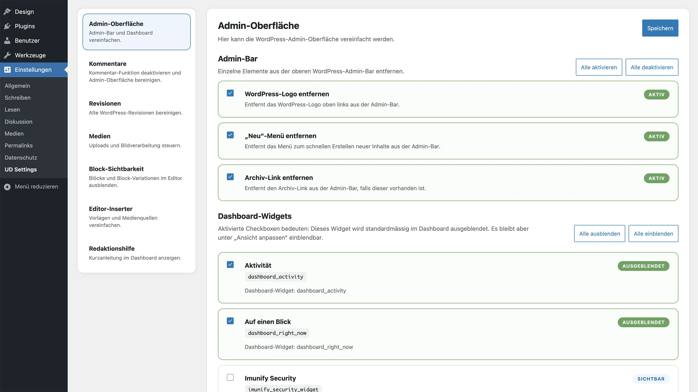

# UD Settings

WordPress-Plugin für wiederverwendbare Projekt- und Editor-Einstellungen. Er hält administrative Funktionen aus dem Theme heraus und bündelt sie in einer zentralen Oberfläche.



## Funktionen

- Admin-Oberfläche bereinigen
- Block-Sichtbarkeit steuern
- Kommentare global deaktivieren
- Editor-Werkzeuge und Standardvorlagen reduzieren
- Inserter und Medienquellen einschränken
- Redaktionshilfe im Dashboard bereitstellen
- Medien- und Bildverarbeitung konfigurieren
- Revisionen bereinigen

Ausgeblendete Blöcke werden nicht deregistriert; vorhandene Inhalte bleiben erhalten. Medien und Revisionen werden nur bei ausdrücklich ausgelösten Aktionen verändert.

## Entwicklung

```bash
npm install
npm run build
```

Watch-Modus:

```bash
npm run start
```

Neue Optionen werden modular unter `includes/options/` und `src/options/` angelegt. Kompilierte Dateien liegen in `build/`.

Wenn der Plugin in einem Theme gebündelt wird, müssen die gebündelte und die installierte Kopie nach Änderungen synchronisiert werden.

## Autor

[ulrich.digital gmbh](https://ulrich.digital)

## Lizenz

[GPL v2 or later](https://www.gnu.org/licenses/gpl-2.0.html)

## Optionsseiten-Standard (21. Oktober 2026)

Referenz: https://chatgpt.com/space/page_492e27c20ea48191a6366fa2aebef97d

Gelber Kopfbereich, native Systemschrift, kompakte graue Navigation und Speicherbuttons in WordPress-Akzentfarbe. Gemeinsame Statusmeldungen erscheinen unten rechts, sind schliessbar und blenden erfolgreiche Meldungen nach acht Sekunden aus; Mauszeiger und Tastaturfokus pausieren die Frist. Nach einem notwendigen Neuladen wird die Speicherbestätigung erneut angezeigt. Fehlermeldungen bleiben bis zum Schliessen sichtbar.

Am 22. Oktober 2026 wurde der vollständige Relaunch-Pluginstand einschliesslich aller acht Funktionsbereiche, Quellen und Builds in dieses Hauptplugin übernommen. Der GitHub-Push steht noch aus.

Verbindliche Ergänzungen vom 22. Oktober 2026:

- Header: gemeinsame HTML-Struktur und `assets/admin-header.css`, maximal 1250px breit, Padding 32px 36px, Radius 14px; Versions-Chip dynamisch. Bis 600px: Padding 22px, Titel 24px, Chip verborgen.
- `assets/admin-buttons.css`: Speicherbuttons und Low Emphasis 2px Radius, alle übrigen Buttons 7px. Header- und Button-CSS bytegleich mit den anderen ulrich.digital-Plugins halten.
- Grosse Inhaltskacheln: Radius 14px, Rahmen 1px solid #dedede, Padding 28px 30px; bis 600px 22px 18px. In UD Settings liegt das Padding auf `.ud-settings-option`, der CardBody bleibt ohne zusätzliches Padding.
- Projektspezifische Upload-Skripte gehören nicht in das Hauptplugin. Die Git-Konfiguration und der vollständige GPL-Lizenztext bleiben erhalten.
